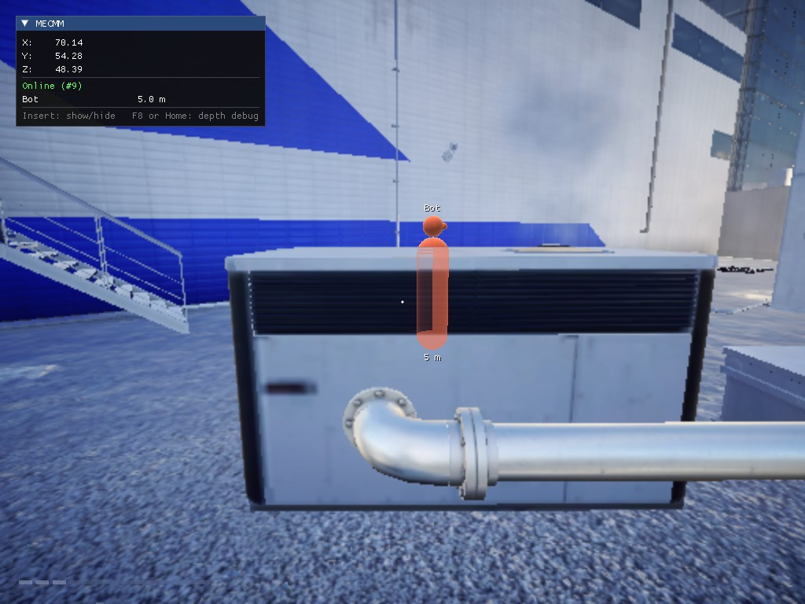
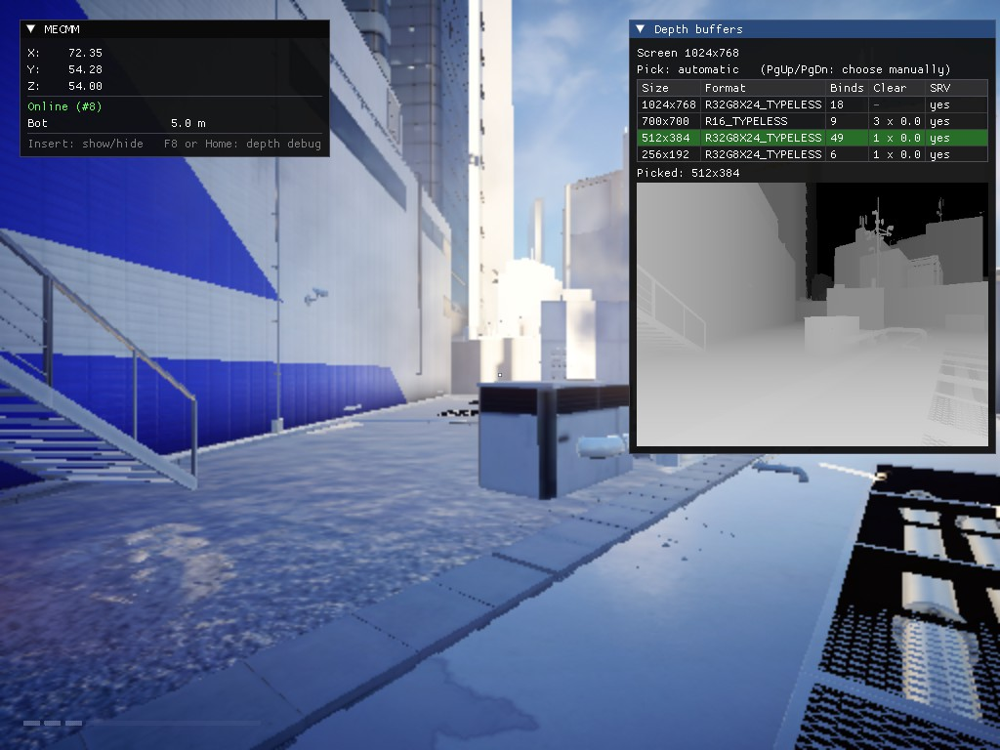

# MECMM — реверс-инжиниринг движка Frostbite 3 на примере Mirror's Edge Catalyst

[English](README.md) · **Русский**

Исследовательский проект, который разбирает **Mirror's Edge Catalyst** (ПК, движок Frostbite 3)
по запущенному процессу игры: где игра хранит игрока и камеру, как рисует глубину сцены, как движок
описывает собственные классы и как устроена система призраков-бегунов. Результаты оформлены в набор
инструментов и работающий **прототип мультиплеерного мода**: игроки подключаются через небольшой
сервер-ретранслятор и видят друг друга в городе как 3D-фигуры, которые правильно прячутся за стенами.

<p align="center">
  
  
</p>

## Результаты

| Область | Результат |
|---|---|
| Игрок | Маршрут указателей к положению Фейт, работающий после перезапуска: `[exe+0x23DA020]+0x700` ([заметки](docs/research/02-player-position.md)) |
| Камера | Вид камеры с матрицами вида и проекции: `[exe+0x2563A10]` (+0x630, +0x6F0); перевод координат мира в экран ([заметки](docs/research/03-camera.md)) |
| Отрисовка | Буфер глубины сцены, найденный через перехват `ID3D11DeviceContext`; другие игроки как 3D-фигуры, скрываемые сценой ([заметки](docs/research/04-depth-buffer.md)) |
| Типы движка | **Дампер SDK**: читает встроенное описание типов Frostbite, ~10 000 классов, структур и перечислений с полями и смещениями ([заметки](docs/research/05-type-info-sdk.md)) |
| Система призраков | Как игра записывает и воспроизводит бегунов в виде анимированных призраков (SDK + чертежи из Frosty + живые объекты) ([заметки](docs/research/06-replay-ghost-system.md)) |
| Сеть | UDP-протокол, сервер-ретранслятор, сглаживание движения, тестовый бот ([заметки](docs/research/07-network.md)) |

Все заметки (на английском): [docs/research/](docs/research/README.md).
Подробное объяснение на русском, что и как сделано: [docs/ru/explained.md](docs/ru/explained.md).

## Инструменты

Инструменты на PowerShell + C#, работают с запущенной игрой (ставить ничего не нужно). Память читается
по частям, поэтому они работают там, где Cheat Engine не хватает памяти на процесс в 12 ГБ.

| Инструмент | Назначение |
|---|---|
| `tools/sdk/sdkdump.ps1` | **Дампер SDK**: все классы, структуры и перечисления движка с полями и смещениями → `tools/output/sdk/` |
| `tools/sdk/instances.ps1` | Поиск живых объектов класса движка (через GetType() в первом слоте vtable) |
| `tools/sdk/inspect.ps1` | Содержимое живого объекта с именами классов по указателям |
| `tools/sdk/fbhash.ps1` | Расшифровка хешей имён Frostbite (идентификаторы событий и полей в чертежах) |
| `tools/memory/heightscan.ps1` | Поиск значений как в Cheat Engine (выросло / уменьшилось / не изменилось) по всей памяти |
| `tools/memory/posscan.ps1` | Поиск троек координат x,y,z и отсев по движению |
| `tools/memory/matscan.ps1` | Поиск матриц положения 4x4 рядом с точкой и отсев по повороту |
| `tools/memory/memwatch.ps1` | Запись значений в CSV, пока окно игры активно |
| `tools/memory/ptrfind.ps1`, `ptrchain.ps1` | Одно- и многоуровневый поиск указателей до постоянных мест в `.exe` |
| `tools/memory/strscan.ps1`, `findbytes.ps1` | Поиск строк, указателей и констант в памяти и коде |
| `tools/memory/showpos.ps1` | Позиция игрока по найденному маршруту |
| `tools/disasm/disasm.ps1` | Дизассемблер расшифрованного кода игры (Iced) |

## Прототип мода

`dinput8.dll`, которую игра загружает сама ([как](docs/research/01-loading-and-overlay.md)):
- окно ImGui: своя позиция, статус подключения, игроки и расстояния до них (**F7**), отладка глубины (**F8**);
- сеть: позиция и направление 30 раз в секунду на сервер-ретранслятор, плавное движение других игроков;
- другие игроки как 3D-фигуры (тело, голова, «нос» по направлению взгляда, свой цвет у каждого),
  скрываемые сценой: за стенами видно бледный силуэт.

Это демонстрация, а не готовый мод: без анимаций, столкновений и меню. Полноценный мультиплеерный мод
на основе призраков самой игры — [MECMP](#похожие-проекты).

### Сборка и запуск

Нужны: Windows 10/11 x64, Mirror's Edge Catalyst (Steam), Visual Studio 2022 с компонентом
«Разработка классических приложений на C++», Git.

```bat
git clone --recursive https://github.com/SLoSkady/MECMM.git
cd MECMM
scripts\build.bat                      :: build\Release\dinput8.dll, mecmm-server.exe, mecmm-bot.exe
scripts\install.bat "D:\путь\к\Mirrors Edge Catalyst"      :: игра закрыта
scripts\run-server.bat                 :: сервер-ретранслятор, UDP 47777
scripts\run-bot.bat                    :: по желанию: бот, который бегает вокруг вас
```

Запускайте игру **с отключённым интернетом** (серверов EA больше нет, с интернетом игра зависает после
вступления) и включайте его уже в игре. Мод создаёт рядом с игрой `mecmm.ini`: адрес сервера, порт,
ник, клавиши. `scripts\uninstall.bat` возвращает игру в исходное состояние.

## Структура проекта

```
MECMM/
├── src/                    прототип мода (C++20) → dinput8.dll
│   ├── core/               точка входа, прокси dinput8, настройки, сетевая сессия, журнал
│   ├── game/               данные игры: позиция и направление игрока, камера, перевод в экран
│   ├── net/                сетевой протокол и UDP-клиент (общие с сервером и ботом)
│   ├── overlay/            перехват Present (D3D11) и интерфейс ImGui
│   └── render/             поиск буфера глубины, 3D-фигуры других игроков
├── server/                 relay/ (mecmm-server.exe), bot/ (mecmm-bot.exe)
├── tools/                  инструменты исследования
│   ├── memory/             сканеры памяти, поиск указателей, просмотрщики
│   ├── sdk/                дампер SDK, поиск и просмотр объектов, расшифровка хешей
│   ├── disasm/             дизассемблер кода игры
│   ├── lib/                библиотека дизассемблера Iced
│   └── output/             сгенерированные данные (сканы, дамп SDK; не в репозитории)
├── docs/research/          заметки исследования (7 глав), скриншоты, таблица Cheat Engine
├── docs/ru/                объяснение проекта на русском
├── scripts/                сборка, установка/удаление, запуск сервера и бота
└── external/               Dear ImGui, MinHook (подмодули Git)
```

## Как это сделано

Проект сделан за несколько вечеров SLoSkady вместе с ИИ-ассистентом для программирования (Claude,
через Claude Code). SLoSkady руководил проектом, выбирал подход на каждом шаге, проводил всё
исследование и тестирование в игре (поиск в памяти, Cheat Engine, выгрузки из Frosty Editor,
скриншоты) и проверял результаты; большая часть кода написана ассистентом по этим указаниям.
Заметки описывают каждый шаг, включая тупики.

## Похожие проекты

- **[MECMP](https://github.com/CodeNameMeteor/mecmp)** (MIT): независимый полноценный мультиплеерный
  мод для MEC, показывающий других игроков анимированными призраками через систему повторов игры.
  Наши выводы об этой системе ([глава 6](docs/research/06-replay-ghost-system.md)) получены
  независимо и совпадают с его документацией.
- [Frosty Tool Suite](https://github.com/CadeEvs/FrostyToolsuite): с его помощью читались чертежи игры.

## Правовая информация

**Неофициальный некоммерческий фанатский проект**, не связан с Electronic Arts или DICE и не одобрен
ими. *Mirror's Edge* — товарный знак Electronic Arts Inc. В репозитории нет файлов и ресурсов игры;
сгенерированные дампы остаются на компьютере пользователя. Для работы нужна легально купленная копия
игры, защита игры не обходится.

## Лицензия

[MIT](LICENSE) © 2026 SLoSkady.
Сторонние компоненты: [Dear ImGui](https://github.com/ocornut/imgui) (MIT),
[MinHook](https://github.com/TsudaKageyu/minhook) (BSD-2-Clause),
[Iced](https://github.com/icedland/iced) (MIT).
